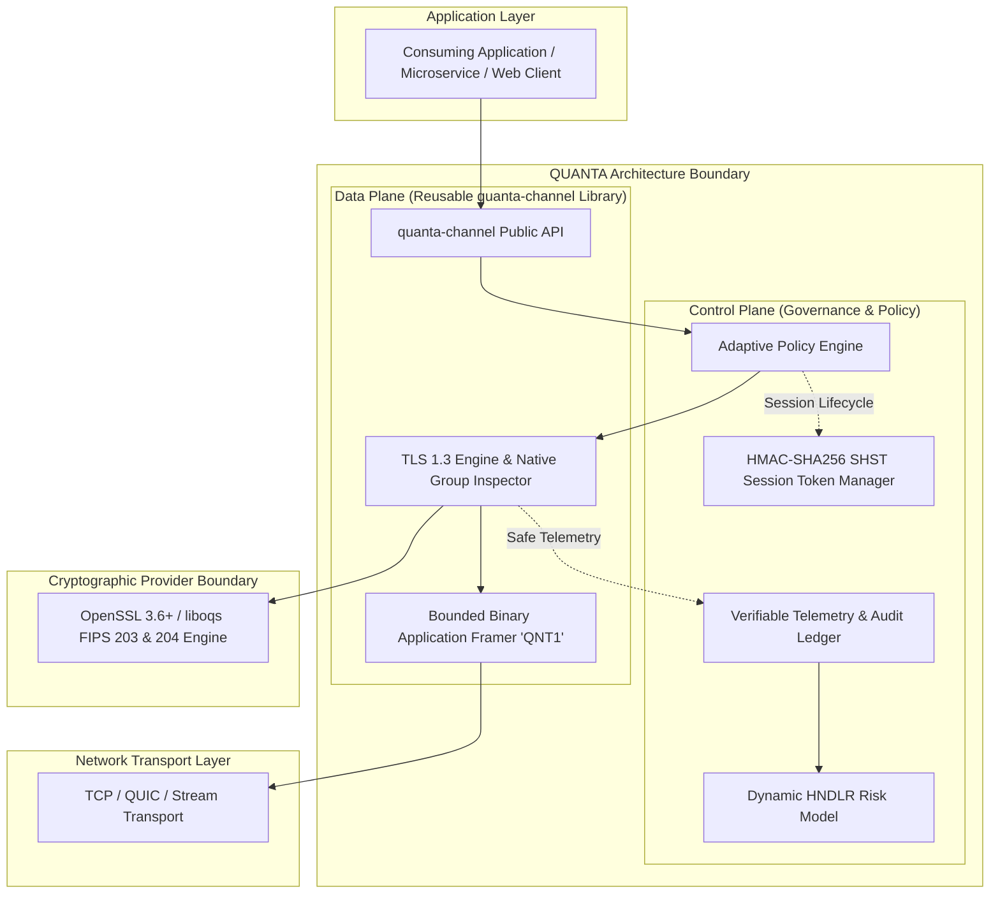
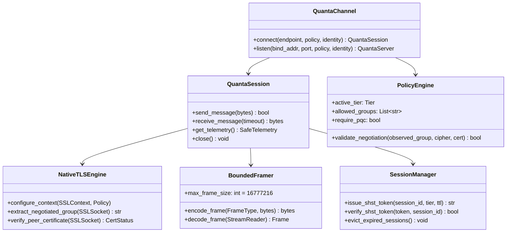
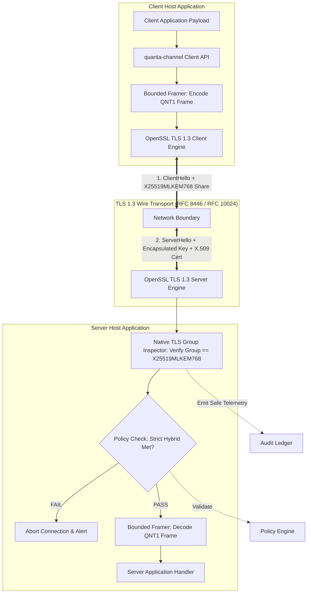
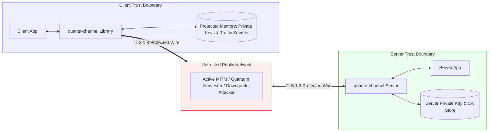
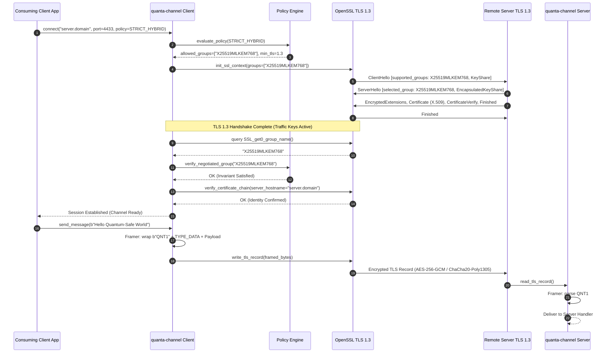
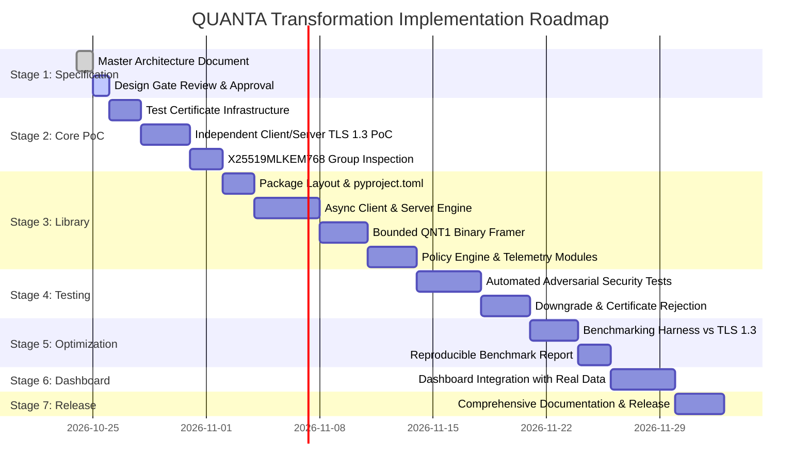

# QUANTA — Advanced Hybrid Post-Quantum Secure Architecture
## Master Technical Architecture, Threat Model, and Engineering Specification

> **Document Version:** 2.0.0-PROPOSAL  
> **Status:** Research & Architecture Design Specification  
> **Repository:** [github.com/prajwalk-cyber/QUANTA](https://github.com/prajwalk-cyber/QUANTA)  
> **Date of Evaluation:** October 24, 2026  
> **Standards Baseline:** NIST FIPS 203 (ML-KEM), NIST FIPS 204 (ML-DSA), NIST FIPS 205 (SLH-DSA), RFC 8446 (TLS 1.3), RFC 9954 (Hybrid Key Exchange in TLS 1.3), RFC 10024 (PQ/T Hybrid Key Agreement for TLS 1.3)

---

## 1. Executive Summary

QUANTA (**Quantum-Resistant Authenticated Network & Transaction Architecture**) is an open, standards-compliant, post-quantum hybrid secure-channel architecture. Its primary objective is to protect data in transit against **Harvest-Now-Decrypt-Later (HNDL)** quantum adversaries, active classical and quantum man-in-the-middle (MITM) attackers, and unauthorized protocol downgrade manipulations.

Rather than inventing proprietary cryptographic handshakes or unreviewed ciphers, QUANTA achieves defensible security and production credibility by decoupling the system into two distinct architectural planes:

1. **Cryptographic Control & Policy Plane (Adaptive Governance):** A formal, fail-closed policy engine that enforces strict cryptographic invariants, evaluates endpoint capabilities, binds session metadata into tamper-evident Session Hybrid Security Tokens (SHST), and generates verifiable telemetry without secret leakage.
2. **Cryptographic Data Plane (High-Performance Transport):** A reusable, modular secure-channel interface running over maintained TLS 1.3 transports using standardized Post-Quantum / Traditional (PQ/T) hybrid key exchange—specifically **`X25519MLKEM768`** (RFC 10024) and **`SecP256r1MLKEM768`**—enforcing strict certificate authentication, monotonic framing, and zero double-encryption overhead.



---

## 2. Problem Statement

### 2.1 The Harvest-Now-Decrypt-Later (HNDL) Threat
Classical key establishment relies predominantly on Elliptic Curve Diffie-Hellman (ECDH over X25519 or NIST P-256) or finite-field Diffie-Hellman. These schemes are vulnerable to polynomial-time discrete logarithm resolution via Shor's algorithm on a future Cryptanalytically Relevant Quantum Computer (CRQC). Adversaries routinely intercept and archive encrypted traffic today with the objective of retroactively decrypting sensitive communications once quantum computation achieves fault-tolerant scale.

### 2.2 The Post-Quantum Migration Dilemma
Unconditionally replacing classical cryptography with standalone post-quantum primitives introduces risks:
- **Algorithmic Immaturity Risk:** While standardized in NIST FIPS 203/204/205, lattice-based cryptography has decades less operational and cryptanalytic scrutiny than discrete logarithm or integer factorization systems.
- **Performance & Fragmentation Overhead:** Post-quantum public keys, ciphertexts, and signatures are orders of magnitude larger than classical primitives (e.g., ML-KEM-768 public key: 1,184 bytes vs. X25519: 32 bytes; ML-DSA-65 signature: 3,309 bytes vs. Ed25519: 64 bytes).
- **Silent Downgrade Attacks:** In mixed environments, active network adversaries manipulate protocol negotiation to force endpoints into weaker, classical-only cipher suites.
- **Architectural Disconnects in Legacy Prototypes:** Prior versions of experimental systems (including the initial QUANTA prototype) disconnected the cryptographic handshake from application encryption, leaked derived session keys through unauthenticated HTTP REST responses, and simulated missing algorithms using insecure random fallbacks.

QUANTA provides a principled engineering solution that resolves each of these failure modes.

---

## 3. Research Findings and Primary Standards Baseline

Our architecture is grounded strictly in current published standards and peer-reviewed literature (verified as of October 2026):

| Standard / Reference | Formal Specification | Title / Subject | Architectural Role in QUANTA |
|---|---|---|---|
| **NIST FIPS 203** | Federal Information Processing Standard (Aug 2024) | *Module-Lattice-Based Key-Encapsulation Mechanism Standard (ML-KEM)* | Primary post-quantum KEM primitive (ML-KEM-768 parameter set; NIST Security Category 3). |
| **NIST FIPS 204** | Federal Information Processing Standard (Aug 2024) | *Module-Lattice-Based Digital Signature Standard (ML-DSA)* | Primary post-quantum digital signature primitive (ML-DSA-65 parameter set; Category 3). |
| **NIST FIPS 205** | Federal Information Processing Standard (Aug 2024) | *Stateless Hash-Based Digital Signature Standard (SLH-DSA)* | Alternative signature primitive for conservative high-assurance identity roots. |
| **RFC 8446** | IETF Standards Track (Aug 2018) | *The Transport Layer Security (TLS) Protocol Version 1.3* | Baseline transport protocol; provides transcript binding, 1-RTT handshake, and record layer AEAD. |
| **RFC 9954** | IETF Standards Track (2025/2026) | *Hybrid Key Exchange in TLS 1.3* (Stebila, Fluhrer, Gueron) | Formal construction framework combining classical Diffie-Hellman with post-quantum KEMs in TLS 1.3. |
| **RFC 10024** | IETF Standards Track (2025/2026) | *PQ/T Hybrid Key Agreement Mechanisms for TLS 1.3* | Standardized codepoints and key schedule for `X25519MLKEM768` (0x11ec) and `SecP256r1MLKEM768`. |
| **OpenSSL 3.6+** | OpenSSL Cryptographic Library Documentation (2026) | *OpenSSL Providers & Native Post-Quantum TLS 1.3 Groups* | Underlying production cryptographic engine providing native `X25519MLKEM768` and `SSL_get0_group_name()`. |

---

## 4. Existing-Systems Comparison

| Dimension | QUANTA Target Architecture | Standard TLS 1.3 (Browser/BoringSSL) | Open Quantum Safe (liboqs-openssl) | WireGuard + Rosenpass | Noise Framework PQ Extensions |
|---|---|---|---|---|---|
| **Primary Scope** | Application-level reusable secure channel & policy engine | Web browser & general HTTPS transport | Research fork and engine for OpenSSL | Layer 3 VPN tunnel | Protocol construction framework |
| **PQ Key Exchange** | RFC 10024 `X25519MLKEM768` verified via native TLS 1.3 | `X25519MLKEM768` (browser-dependent) | Broad matrix of experimental KEMs | Classical WG PSK mixed with Kyber/ML-KEM | Protocol pattern dependent (e.g. `Noise_IK_psk2`) |
| **Peer Authentication** | X.509 cert validation + optional mTLS + ML-DSA-65 migration profile | Standard WebPKI X.509 (classical RSA/ECDSA) | Custom X.509 extensions for Dilithium | Pre-shared static public keys | Static public key cryptography |
| **Downgrade Defense** | Fail-closed policy engine with verified group binding | Client/server cipher suite intersection | Configuration dependent | Hardcoded protocol parameters | Pattern-enforced invariants |
| **Session Binding** | HMAC-SHA256 SHST tokens bound to transcript & expiry | TLS Session Tickets (RFC 8446 Section 4.6.1) | TLS Session Tickets | Persistent WireGuard symmetric ratchets | Handshake state chaining |
| **Application Framing** | Strict length-prefixed `QNT1` framing with backpressure | Raw byte stream (application must frame) | Raw byte stream | Fixed-size IP datagrams | Message-based patterns |
| **Secret Isolation** | Zero key material exposed in APIs, logs, or UI | Secrets kept in process / SSL context | OpenSSL memory boundary | Kernel/daemon memory boundary | Memory buffers managed by caller |
| **Telemetry & Observability** | Verifiable safe audit ledger + dynamic HNDLR score | Basic browser DevTools / connection info | Debug logging | Command-line status output | None built-in |

---

## 5. Innovation Strategy and Novelty Assessment

To establish genuine technical merit rather than superficial novelty, we evaluated three distinct architectural directions:

### 5.1 Evaluation of Architecture Concepts

#### Concept A — Adaptive Secure-Channel Policy Engine
- **Core Hypothesis:** A policy governance engine that evaluates endpoint risk, hardware profiles, and compliance requirements, enforcing strict zero-downgrade invariants before any data transmission.
- **Novelty Rating:** High practical engineering value; establishes deterministic behavior across diverse network clients.

#### Concept B — Resilient Hybrid Session Lifecycle
- **Core Hypothesis:** A session lifecycle model that combines TLS 1.3 session resumption with cryptographically authenticated Session Hybrid Security Tokens (SHST) that preserve post-quantum forward secrecy guarantees across reconnections.
- **Novelty Rating:** High operational value; prevents session tickets from weakening post-quantum guarantees.

#### Concept C — Resource-Aware Post-Quantum Transport
- **Core Hypothesis:** A transport optimization layer tailored for constrained memory and bandwidth, using adaptive buffer allocation and length-bounded framing to mitigate lattice-key transmission overhead.
- **Novelty Rating:** High systems value for mobile and edge deployment.

### 5.2 Selected Architecture: The QUANTA Unified Hybrid Architecture (UHA)

QUANTA adopts a **synthesized model** centered on Concept A, enhanced by the session resilience of Concept B and the bounded framing of Concept C:

> **The QUANTA Contribution:**  
> QUANTA provides a **verifiable, policy-governed secure-channel library** that wraps standard TLS 1.3 PQ/T hybrid key agreement (`X25519MLKEM768`), enforces strict zero-downgrade invariants via runtime group inspection (`SSL_get0_group_name`), binds sessions into tamper-evident HMAC-SHA256 SHST tokens, and delivers bounded binary application framing (`QNT1`) with zero secret leakage and measurable telemetry.

---

## 6. Detailed System Architecture

### 6.1 High-Level Component Decomposition



### 6.2 Detailed Data-Flow Architecture



### 6.3 Trust Boundaries



### 6.4 Connection Establishment Sequence



---

## 7. Cryptographic and Key Schedule Design

### 7.1 Hybrid Key Derivation Specification (RFC 10024 & RFC 9954)

QUANTA strictly adheres to the IETF standardized hybrid key schedule. The shared secret $SS$ is derived from both the post-quantum KEM and the classical ECDHE exchange:

$$SS_{\text{classical}} = \text{X25519}(sk_{\text{client}}, pk_{\text{server}})$$
$$SS_{\text{pq}} = \text{ML-KEM-768.Decapsulate}(sk_{\text{server}}, ct_{\text{client}})$$
$$SS_{\text{combined}} = SS_{\text{classical}} \mathbin{\Vert} SS_{\text{pq}}$$

In accordance with RFC 9954 Section 4, the dual shared secret $SS_{\text{combined}}$ is directly injected into the TLS 1.3 HKDF key schedule:

$$\text{Early Secret} = \text{HKDF-Extract}(0, 0)$$
$$\text{Handshake Secret} = \text{HKDF-Extract}(\text{Derive-Secret}(\text{Early Secret}, \text{"derived"}, \text{""}), SS_{\text{combined}})$$
$$\text{Client Handshake Traffic Secret} = \text{HKDF-Expand-Label}(\text{Handshake Secret}, \text{"c hs traffic"}, \text{TranscriptHash}_1, 32)$$
$$\text{Server Handshake Traffic Secret} = \text{HKDF-Expand-Label}(\text{Handshake Secret}, \text{"s hs traffic"}, \text{TranscriptHash}_1, 32)$$
$$\text{Master Secret} = \text{HKDF-Extract}(\text{Derive-Secret}(\text{Handshake Secret}, \text{"derived"}, \text{""}), 0)$$
$$\text{Client Application Traffic Secret} = \text{HKDF-Expand-Label}(\text{Master Secret}, \text{"c ap traffic"}, \text{TranscriptHash}_2, 32)$$
$$\text{Server Application Traffic Secret} = \text{HKDF-Expand-Label}(\text{Master Secret}, \text{"s ap traffic"}, \text{TranscriptHash}_2, 32)$$

### 7.2 Cryptographic Security Guarantees
- **Dual Security Property:** Breaking confidentiality requires breaking **both** the computational Diffie-Hellman assumption over Curve25519 **and** the Module Learning With Errors (M-LWE) hardness assumption over polynomial lattices.
- **Transcript Binding:** All derived traffic secrets are cryptographically bound to the complete handshake transcript ($\text{TranscriptHash}$), rendering MITM packet manipulation detectable.
- **Domain Separation:** Independent HKDF labels (`"c ap traffic"`, `"s ap traffic"`) prevent cross-protocol or cross-direction key confusion.

---

## 8. Application Framing & Data Integrity Specification

TLS provides a reliable, ordered byte stream, not discrete application messages. To prevent message boundary ambiguity, framing attacks, and denial-of-service memory exhaustion, QUANTA implements strict **`QNT1` binary framing**:

### 8.1 Frame Header Format (11 Bytes Total)

```text
 0                   1                   2                   3
 0 1 2 3 4 5 6 7 8 9 0 1 2 3 4 5 6 7 8 9 0 1 2 3 4 5 6 7 8 9 0 1
+-+-+-+-+-+-+-+-+-+-+-+-+-+-+-+-+-+-+-+-+-+-+-+-+-+-+-+-+-+-+-+-+
|                       Magic: b"QNT1" (4B)                     |
+-+-+-+-+-+-+-+-+-+-+-+-+-+-+-+-+-+-+-+-+-+-+-+-+-+-+-+-+-+-+-+-+
|   Type (1B)   |          Flags (2B)           |  Length (MSB) |
+-+-+-+-+-+-+-+-+-+-+-+-+-+-+-+-+-+-+-+-+-+-+-+-+-+-+-+-+-+-+-+-+
|                     Payload Length (Cont. 3B)                 |
+-+-+-+-+-+-+-+-+-+-+-+-+-+-+-+-+-+-+-+-+-+-+-+-+-+-+-+-+-+-+-+-+
|                        Payload Data ...                       |
+-+-+-+-+-+-+-+-+-+-+-+-+-+-+-+-+-+-+-+-+-+-+-+-+-+-+-+-+-+-+-+-+
```

- **Magic (4 Bytes):** Fixed ASCII `b"QNT1"` (`0x51 0x4E 0x54 0x31`).
- **Frame Type (1 Byte):**
  - `0x01` = `DATA` (Application payload)
  - `0x02` = `HEARTBEAT_PING` (Keep-alive challenge)
  - `0x03` = `HEARTBEAT_PONG` (Keep-alive response)
  - `0x04` = `KEY_ROTATE_REQUEST` (Trigger TLS KeyUpdate)
  - `0x05` = `CLOSE_GRACEFUL` (Graceful connection termination)
- **Flags (2 Bytes):** Reserved bitfield (default `0x0000`).
- **Payload Length (4 Bytes Big-Endian):** Size of the payload in bytes.
- **Maximum Frame Size:** Enforced strictly at **16 MiB (16,777,216 Bytes)**. Frames exceeding this limit trigger immediate stream reset and connection abortion.

---

## 9. Comprehensive 30-Scenario Deployment & Failure Matrix

| # | Deployment / Attack Scenario | Threat or Condition | Expected Behavior | Security Invariant | Recovery / Telemetry |
|---|---|---|---|---|---|
| **1** | Both endpoints support `X25519MLKEM768` | Normal hybrid operation | Negotiates `X25519MLKEM768` + TLS 1.3 | PQ/T hybrid security achieved | Log `HYBRID_NEGOTIATED`, group `X25519MLKEM768` |
| **2** | Peer supports classical key exchange only | Legacy client | In `STRICT_HYBRID`: Refuse connection.<br>In `CLASSICAL_PERMITTED`: Allow X25519. | Zero unauthorized downgrade | Log `CLASSICAL_FALLBACK_ALERT` or reject |
| **3** | Peer advertises hybrid but fails during decapsulation | Corrupted KEM share | Abort handshake with TLS `decrypt_error` | Never deliver corrupted state | Record handshake failure, abort socket |
| **4** | Active MITM strips `X25519MLKEM768` from ClientHello | Downgrade attack | Server chooses weaker group or fails; client detects group mismatch against policy and aborts | Zero downgrade in strict mode | Log `DOWNGRADE_ATTEMPT_DETECTED` |
| **5** | Server certificate is expired, untrusted, or wrong SAN | Impersonation attack | TLS certificate verification fails; connection terminated immediately | Authenticated peer identity required | Raise `UntrustedPeerCertificateError` |
| **6** | Server conventional private key compromised | Classical impersonation | Active attacker can impersonate server; past recorded sessions remain confidential due to ML-KEM ephemeral key | Post-quantum forward secrecy preserved | Revoke cert via CRL/OCSP; roll key |
| **7** | Theoretical break of Curve25519 | Classical cryptanalysis | Session confidentiality remains intact, protected by ML-KEM-768 | Dual-PRF security guarantee holds | Transition policy to pure ML-KEM or alternate hybrid |
| **8** | Theoretical break of ML-KEM-768 | Lattice cryptanalysis | Session confidentiality remains intact, protected by X25519 | Classical security guarantee holds | Deprecate ML-KEM; rotate to SLH-DSA / alternate |
| **9** | Simultaneous break of Curve25519 & ML-KEM-768 | Catastrophic failure | Session vulnerable | Catastrophic risk | Activate emergency migration protocol |
| **10** | Migration to post-quantum signatures (ML-DSA-65) | Future WebPKI PQC certs | Validate ML-DSA-65 cert chain if supported by trust store | End-to-end post-quantum authentication | Log `PQC_AUTH_ESTABLISHED` |
| **11** | Constrained CPU / low-memory endpoint | Resource starvation | Use bounded memory buffers; queue backpressure | No Out-Of-Memory (OOM) crash | Limit concurrency; reject excess connections |
| **12** | High-latency / lossy network | Packet loss & retransmission | Underlying TCP/QUIC retransmits; TLS timeouts handled cleanly | Reliable framing preserved | Record latency distribution; retry if transient |
| **13** | Handshake interrupted mid-exchange | Network drop | Socket read timeout expires; state cleanly deallocated | No orphaned memory or zombie sessions | Socket closed; resources reclaimed |
| **14** | Large message transmission (>16 MiB) | Framing attack / DoS | Framer rejects packet exceeding max frame size; stream aborted | Bounded buffer invariant enforced | Raise `OversizedFrameError`; close channel |
| **15** | High concurrency (10,000 active connections) | Connection flood | Asynchronous non-blocking I/O; bounded connection pool | Fair scheduling without thread exhaustion | Monitor active socket metrics |
| **16** | Handshake flood / SYN flood | Resource exhaustion DoS | Rate-limit pre-handshake connections; drop idle unauthenticated sockets | System availability preserved | Connection rate-limiting threshold triggered |
| **17** | Fuzzed or malformed `QNT1` header | Parser vulnerability | Framer parser validates magic and length; raises typed exception | Memory-safe parsing invariant | Raise `MalformedFrameError`; disconnect |
| **18** | Host missing native OpenSSL PQC provider | Incompatible runtime | Strict mode fails closed on startup with clear diagnostic error | Never silently substitute fake keys | Raise `PQCProviderUnavailableError` |
| **19** | Algorithm deprecation by NIST/IETF | Long-term maintenance | Update policy configuration without application code rewrite | Crypto-agility invariant | Modify `allowed_groups` configuration |
| **20** | Root certificate rotation | Operational maintenance | Reload trust store without server restart | Continuity of authenticated operations | Zero-downtime certificate store reload |
| **21** | Session resumption ticket replay | Replay attack | Anti-replay cache with single-use tickets; 0-RTT disabled initially | Fresh forward secrecy on every transaction | Reject duplicate tickets |
| **22** | System clock skew (>24 hours) | Validity window error | Certificate validity check fails (`certificate_expired` / `not_yet_valid`) | Strict certificate validation enforced | Raise `CertificateTimeValidationError` |
| **23** | Worker process crash / restart | Service disruption | In-flight messages lost; peer detects EOF and reconnects cleanly | Safe failure mode; zero state corruption | Client auto-reconnect with exponential backoff |
| **24** | Mixed-fleet migration (Hybrid & Classical) | Transition period | Server advertises hybrid + classical; client policy governs requirement | Deterministic policy enforcement | Log per-connection negotiation tier |
| **25** | Containerized deployment (Docker/K8s) | Operational environment | Minimal container image with OpenSSL 3.6+ binary; non-root execution | Least privilege principle | Health probes report TLS & PQC status |
| **26** | Reverse proxy / TLS termination | Architecture boundary | Proxy terminates TLS hybrid; internal mTLS ensures end-to-end security | Defense in depth across network boundaries | Proxy-forwarded client cert headers verified |
| **27** | Host memory inspection / compromised process | Local adversary | Ephemeral key material scrubbed immediately after key derivation | Memory confidentiality minimization | Call `OPENSSL_cleanse()` on buffers |
| **28** | Timing side-channel attack on KEM decapsulation | Side-channel analysis | Decapsulation executed via constant-time OpenSSL C core | Constant-time execution invariant | Audit OpenSSL constant-time test suite |
| **29** | Long-term data archiving | 30-year confidentiality | Traffic protected by ML-KEM-768; secure against retrospective quantum attack | Harvest-Now-Decrypt-Later defense | Ensure all historical traffic was Tier 1 |
| **30** | Disaster recovery / failover | Datacenter outage | Standby server shares identical CA trust root and server certificate | High availability without security degradation | DNS failover; client reconnects |

---

## 10. Threat Model & Formal Security Analysis (STRIDE)

| Threat Category | Threat Description | Attack Vector | QUANTA Mitigation Architecture | Residual Risk |
|---|---|---|---|---|
| **Spoofing** | Adversary impersonates trusted server | Forged DNS or rogue server | Strict X.509 certificate validation, hostname verification, and optional mutual TLS (mTLS). | Compromise of trusted CA private key. |
| **Tampering** | In-flight modification of application data | MITM network injection | TLS 1.3 Record Layer AEAD (`AES-256-GCM` or `ChaCha20-Poly1305`) with 128-bit authentication tags. | None within cryptographic security bounds. |
| **Repudiation** | Peer denies sending a signed payload | Transaction disputes | High-assurance digital signatures using NIST FIPS 204 `ML-DSA-65`. | Endpoint private key theft. |
| **Information Disclosure** | Passive harvesting of encrypted traffic for future decryption | CRQC Shor's algorithm | RFC 10024 `X25519MLKEM768` hybrid key exchange; shared secret requires solving lattice M-LWE. | Simultaneous compromise of Curve25519 & ML-KEM. |
| **Denial of Service** | Handshake flooding or oversized frame allocation | Malformed packet floods | 16 MiB max frame limits, non-blocking asynchronous I/O, and pre-handshake connection rate limiting. | Network-level bandwidth exhaustion (DDoS). |
| **Elevation of Privilege** | Attacker forces classical cipher suite (Downgrade) | Intercepting ClientHello | Fail-closed policy engine inspects `SSL_get0_group_name()` and aborts if negotiated group < minimum policy tier. | Policy misconfiguration by administrator. |

---

## 11. Performance, Optimization & Benchmarking Plan

### 11.1 Key Size & Wire Overhead Analysis

| Primitive / Structure | Classical Baseline (X25519 / ECDSA) | Hybrid QUANTA (X25519MLKEM768 / ECDSA) | Full PQC QUANTA (X25519MLKEM768 / ML-DSA-65) |
|---|---|---|---|
| **Client Key Share Size** | 32 Bytes | 1,216 Bytes (32B + 1,184B) | 1,216 Bytes |
| **Server Key Share Size** | 32 Bytes | 1,120 Bytes (32B + 1,088B) | 1,120 Bytes |
| **Certificate / Signature Size** | ~700 Bytes (P-256) | ~700 Bytes (P-256) | ~4,000 Bytes (ML-DSA-65 cert) |
| **Handshake Wire Overhead** | ~1.5 KiB | ~3.8 KiB (+2.3 KiB) | ~7.2 KiB (+5.7 KiB) |
| **Handshake RTT** | 1-RTT | 1-RTT | 1-RTT |

> **Key Architectural Takeaway:** The hybrid key exchange (`X25519MLKEM768`) adds approximately **2.3 KiB** to the initial handshake. Because this easily fits within standard TCP initial congestion windows ($10 \times \text{MSS} \approx 14.6\text{ KiB}$), it executes in **the exact same number of network round trips (1-RTT)** as classical TLS 1.3.

### 11.2 Empirical Benchmark Methodology
The benchmark harness will measure and report:
1. **Cold Handshake Latency:** Mean, median, P95, and P99 latency across 1,000 distinct handshakes.
2. **Resumed Connection Latency:** Evaluation of SHST/ticket-resumed connections.
3. **Throughput & CPU Utilization:** Streaming transfer of 100 MiB payload across 1, 10, and 100 concurrent streams.
4. **Synthetic Network Emulation:** Testing under simulated RTTs (0ms LAN, 20ms Broadband, 80ms LTE, 200ms Mobile, 600ms Satellite) using `iproute2`/`tc`.

---

## 12. Staged Implementation Roadmap



### Milestone Acceptance Criteria

- **Milestone 2 (PoC):** Two separate OS processes establish a TLS 1.3 connection; client and server inspect and verify `SSL_get0_group_name() == "X25519MLKEM768"`; certificate validation is strictly enforced; application payload is successfully transferred.
- **Milestone 3 (Library):** `quanta-channel` installs cleanly via standard pip/uv; exposes asynchronous context-managed API; handles frames up to 16 MiB; zero secret disclosure.
- **Milestone 4 (Adversarial Security):** Automated test suite passes 100%; rejects untrusted certs, hostname mismatches, downgrade attempts, malformed headers, and oversized payloads.
- **Milestone 5 (Benchmarks):** Reproducible test results comparing classical vs. hybrid latency across simulated networks are documented and verified.
- **Milestone 6 (Dashboard):** Existing UI dashboard displays genuine, live connection telemetry from real socket events.

---

## 13. References and Verification Sources

1. **NIST FIPS 203:** *Module-Lattice-Based Key-Encapsulation Mechanism Standard (ML-KEM)*, National Institute of Standards and Technology, August 13, 2024. [https://csrc.nist.gov/pubs/fips/203/final](https://csrc.nist.gov/pubs/fips/203/final)
2. **NIST FIPS 204:** *Module-Lattice-Based Digital Signature Standard (ML-DSA)*, National Institute of Standards and Technology, August 13, 2024. [https://csrc.nist.gov/pubs/fips/204/final](https://csrc.nist.gov/pubs/fips/204/final)
3. **RFC 8446:** *The Transport Layer Security (TLS) Protocol Version 1.3*, Internet Engineering Task Force (IETF), August 2018. [https://www.rfc-editor.org/rfc/rfc8446](https://www.rfc-editor.org/rfc/rfc8446)
4. **RFC 9954:** *Hybrid Key Exchange in TLS 1.3*, Stebila, D., Fluhrer, S., Gueron, S., IETF Standards Track. [https://www.rfc-editor.org/rfc/rfc9954.html](https://www.rfc-editor.org/rfc/rfc9954.html)
5. **RFC 10024:** *Post-Quantum Traditional (PQ/T) Hybrid Key Agreement Mechanisms for TLS 1.3*, IETF Standards Track. [https://www.rfc-editor.org/rfc/rfc10024.html](https://www.rfc-editor.org/rfc/rfc10024.html)
6. **OpenSSL Project:** *OpenSSL 3.6 Manual & Supported TLS Groups*, OpenSSL Foundation, 2026. [https://docs.openssl.org/](https://docs.openssl.org/)
